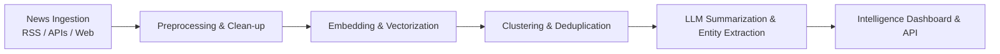

# News Intelligence System

A modern, AI-powered News Intelligence and Event Analysis platform designed for automated news aggregation, event clustering, semantic analysis, and real-time summarization.

---

## 📌 Overview

The **News Intelligence System** continuously ingests articles from multiple news sources, eliminates duplicate coverage, groups unfolding stories into unified events, and generates concise, actionable summaries. By applying advanced Natural Language Processing (NLP) and Large Language Models (LLMs), it enables analysts and users to quickly cut through the noise and stay informed on critical developments.

---

## ✨ Key Features

- **Multi-Source News Ingestion**: Automated collection from RSS feeds, news APIs, and web sources.
- **Semantic Event Clustering**: Groups related news articles covering the same unfolding event using vector embeddings and similarity metrics.
- **AI-Powered Summarization**: Generates high-level executive summaries and key bullet-point takeaways.
- **Sentiment & Bias Tracking**: Evaluates article tone, sentiment shifts, and perspective divergence across publishers.
- **Named Entity Recognition (NER)**: Automatically extracts key individuals, organizations, locations, and geopolitical entities.
- **Real-Time Intelligence Dashboard**: Interactive interface for browsing breaking events, trending topics, and topic timelines.

---

## 🏗️ Architecture & Pipeline



---

## 📁 Project Structure

```text
news_intelligence_system/
├── data/               # Raw and processed news datasets / cache
├── pipeline/           # News ingestion, scraping, and preprocessing
├── models/             # Clustering, embeddings, and NLP/LLM modules
├── api/                # Backend REST API (FastAPI / Flask)
├── web/                # Frontend dashboard / visualization UI
├── tests/              # Unit and integration test suites
├── requirements.txt    # Python dependencies
├── .env.example        # Environment variable configuration template
└── README.md           # Project documentation
```

---

## 🚀 Getting Started

### Prerequisites

- Python 3.10+
- `pip` / `virtualenv`
- Git

### Installation

1. **Clone the repository:**
   ```bash
   git clone https://github.com/sujanyd/News_Intelligence_system.git
   cd News_Intelligence_system
   ```

2. **Create and activate a virtual environment:**
   ```bash
   python3 -m venv .venv
   source .venv/bin/activate
   ```

3. **Install dependencies:**
   ```bash
   pip install -r requirements.txt
   ```

4. **Set up environment variables:**
   ```bash
   cp .env.example .env
   # Add your API keys and configuration
   ```

---

## ⚙️ Configuration

Create a `.env` file in the root directory:

```env
# API Keys & Endpoints
NEWS_API_KEY=your_news_api_key_here
OPENAI_API_KEY=your_openai_api_key_here

# App Settings
ENVIRONMENT=development
LOG_LEVEL=INFO
```

---

## 🤝 Contributing

Contributions are welcome! Please feel free to submit a Pull Request or open an Issue for suggestions and feature requests.

1. Fork the Project
2. Create your Feature Branch (`git checkout -b feature/AmazingFeature`)
3. Commit your Changes (`git commit -m 'Add some AmazingFeature'`)
4. Push to the Branch (`git push origin feature/AmazingFeature`)
5. Open a Pull Request

---

## 📄 License

Distributed under the MIT License. See `LICENSE` for more information.
