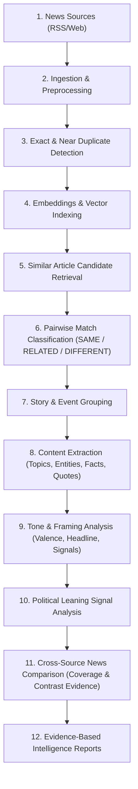

# Backend Architecture (70% Milestone)

## 1. High-Level System Architecture

The **Multi-Source News Intelligence System** is built on a modular FastAPI backend, SQLAlchemy ORM data access layer, Qdrant vector database service, and rule/lexicon-based analytical reasoning engines.

```
+-----------------------------------------------------------------------------------+
|                                FASTAPI APPLICATION                                |
|                                                                                   |
|  /api/sources         /api/articles         /api/stories         /api/events      |
|  /api/ingestion       /api/embeddings       /api/similarity      /api/matching    |
|  /api/articles/...    /api/comparisons      /api/reports         /api/health      |
+------------------------------------------+----------------------------------------+
                                           |
                                  Dependency Injection
                                           |
+------------------------------------------v----------------------------------------+
|                                CORE SERVICE LAYER                                 |
|                                                                                   |
|  - RSS Ingestion Service         - Text Preprocessing Pipeline                    |
|  - Duplicate Detection Service   - Embedding & Vector DB Service (Qdrant)         |
|  - Pairwise Classification (SAME / RELATED / DIFFERENT)                          |
|  - Story & Event Grouping Engine                                                  |
|  - Article Content Extraction (Topics, Entities, Facts, Quotes)                   |
|  - Tone & Framing Analysis Engine (Valence & Frame Signals)                       |
|  - Political Leaning & Slant Analysis Engine                                      |
|  - Cross-Source News Comparison Engine (Coverage & Evidence)                      |
|  - Evidence-Based Report Generation Engine                                        |
+------------------------------------------+----------------------------------------+
                                           |
                              Object Relational Mapping
                                           |
+------------------------------------------v----------------------------------------+
|                                  DATA STORES                                      |
|                                                                                   |
|  - Primary Relational DB: PostgreSQL (Production) / SQLite (Standalone Demo Mode) |
|    (Full 21-Table Normalized Schema Enforcing Foreign Key Integrity)              |
|                                                                                   |
|  - Vector Store: Qdrant Client (Persistent Remote or In-Memory Demo)             |
+-----------------------------------------------------------------------------------+
```

---

## 2. End-to-End Pipeline Data Flow

The core pipeline processes news articles through 10 distinct dependency stages:



---

## 3. Core Architectural Modules

### 1. Ingestion & Preprocessing (`app/services/rss_ingestion.py`, `app/services/text_preprocessing.py`)
- Pulls XML/Atom RSS feeds from configured news sources.
- Cleans HTML markup, normalizes Unicode and whitespace, extracts publication timestamps, and generates canonical URLs.
- Stores initial records in `articles` with `content_availability` tracking (`full_text`, `summary_only`, `headline_only`).

### 2. Duplicate Detection (`app/services/duplicate_detection.py`)
- **Exact Duplicates**: Identified using canonical URL matching and SHA-256 content hashes.
- **Near-Duplicates**: Evaluates k-shingle Jaccard overlap and word vocabulary metrics ($\ge 0.60$).
- Links duplicates using the self-referential `duplicate_of_article_id` foreign key on the `articles` table, preserving the primary canonical original.

### 3. Embeddings & Vector Search (`app/services/embedding.py`, `app/services/vector_db.py`, `app/services/similarity.py`)
- Generates 384-dimensional dense vectors for headlines and content bodies.
- Indexed in Qdrant collections (`news_articles`).
- Supports candidate retrieval with cosine similarity scoring, excluding self-matches.

### 4. Article Matching (`app/services/matching.py`)
- Classifies candidate pairs into `SAME` (identical event), `RELATED` (connected development), or `DIFFERENT` (unrelated subject).
- Combines semantic vectors, salient named entity overlap (Jaccard index), publication recency delta, and foreign key relations.
- Persists canonical pairs $(id_1 < id_2)$ in `article_matches`.

### 5. Story and Event Grouping (`app/services/story_grouping.py`)
- Distinguishes overarching news narratives (`stories`) from localized real-world occurrences (`events`).
- Maintains distinct timestamps for `event_time`, `event_time_precision` (`exact`, `date`, `range`, `unknown`), and `event_time_disagreement`.

### 6. Content Extraction (`app/services/content_extraction.py`)
- Extracts salient topics (`analysis_topics`), named entities (`entities`), unverified factual statements (`analysis_facts`), and direct quotes (`analysis_quotes`).
- Canonicalizes entities to avoid row duplication across articles.

### 7. Tone & Framing Analysis (`app/services/tone_framing.py`)
- Categorizes article tone (`neutral`, `positive`, `negative`, `critical`, `alarming`, `optimistic`).
- Evaluates headline framing (`conflict_emphasis`, `blame_attribution`, `urgency`, `economic_consequence`, `achievement_progress`, `neutral_reporting`).
- Extracts sentence-level rhetorical framing cues with character offsets into `analysis_framing_signals`.

### 8. Political Leaning Signals (`app/services/political_signal.py`)
- Identifies political parties, politicians, and governmental institutions.
- Extracts favorable vs. unfavorable presentation cues.
- Computes continuous ideological slant (-1.0 Far-Left to +1.0 Far-Right) and partisanship scores (0.0 to 1.0).

### 9. Cross-Source News Comparison (`app/services/comparison.py`)
- Gathers articles covering the same event across publishers.
- Evaluates relative coverage depth and identifies omitted topics (`comparison_coverages`).
- Extracts verbatim contrastive evidence items with character ranges (`comparison_evidences`).
- Associates per-article political signals (`comparison_political_signals`).

### 10. Evidence-Based Reports (`app/services/report.py`)
- Synthesizes comparative findings into comprehensive intelligence reports (`reports`).
- Generates formatted Markdown, HTML, or structured JSON.
- Grounded in empirical citations with explicit limitations and uncertainty statements.
