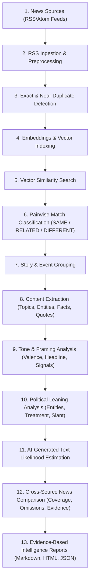

# Backend Architecture (Milestone 90%)

## 1. High-Level System Architecture

The **Multi-Source News Intelligence System** backend is an enterprise-grade FastAPI application engineered with a clean modular architecture:

```
+-----------------------------------------------------------------------------------------+
|                                  FASTAPI APPLICATION LAYER                              |
|                                                                                         |
|  /api/health            /api/sources         /api/articles         /api/stories         |
|  /api/events            /api/ingestion       /api/embeddings       /api/similarity      |
|  /api/matches           /api/comparisons     /api/reports          /api/articles/...    |
+--------------------------------------------+--------------------------------------------+
                                             |
                                  Dependency Injection (get_db)
                                             |
+--------------------------------------------v--------------------------------------------+
|                                    CORE SERVICE LAYER                                   |
|                                                                                         |
|  - RSS Ingestion Service           - Text Preprocessing Pipeline                        |
|  - Duplicate Detection Service     - Embedding & Vector DB Service (Qdrant)             |
|  - Pairwise Classification Service (SAME / RELATED / DIFFERENT)                         |
|  - Story & Event Grouping Engine   - Article Content Extraction Service                 |
|  - Tone & Framing Analysis Engine  - Political Leaning Analysis Engine                  |
|  - AI-Generated Text Detection Engine                                                   |
|  - Cross-Source News Comparison Engine (Coverage Discrepancies & Contrastive Evidence)  |
|  - Evidence-Based Intelligence Report Generation Engine                                 |
+--------------------------------------------+--------------------------------------------+
                                             |
                                  SQLAlchemy Relational ORM
                                             |
+--------------------------------------------v--------------------------------------------+
|                                     DATA STORAGE TIER                                   |
|                                                                                         |
|  - Primary Relational Database:                                                         |
|      * PostgreSQL (Production Mode) / SQLite (Zero-Dependency Standalone Demo Mode)     |
|      * Full 21-Table Normalized Schema Enforcing Foreign Key Cascades & Constraints     |
|                                                                                         |
|  - Vector Storage Tier:                                                                 |
|      * Persistent Qdrant Server (Production) / In-Memory Qdrant Client (Demo & Tests)  |
+-----------------------------------------------------------------------------------------+
```

---

## 2. End-to-End Pipeline Data Flow

The full news intelligence pipeline flows through 11 interconnected stages:



---

## 3. Core Architectural Modules

### 1. RSS Ingestion & Preprocessing (`app/services/rss_ingestion.py`, `app/services/text_preprocessing.py`)
- Ingests XML/Atom feeds from configured news outlets.
- Strips HTML tags, decodes Unicode entities, resolves canonical URLs, and computes SHA-256 hashes.
- Tracks `content_availability` (`full_text`, `summary_only`, `headline_only`).

### 2. Duplicate Detection (`app/services/duplicate_detection.py`)
- Evaluates exact hash matches and k-shingle Jaccard overlap ($\ge 0.60$).
- Links syndicated and duplicate articles via the self-referential `duplicate_of_article_id` on the `articles` table, designating the earliest article as canonical.

### 3. Embeddings & Vector Search (`app/services/embedding.py`, `app/services/vector_db.py`, `app/services/similarity.py`)
- Computes dense embeddings for headlines and content bodies.
- Indexes vectors in Qdrant (`news_articles` collection).
- Retrieves candidate matches using cosine similarity with automatic self-exclusion.

### 4. Pairwise Classification (`app/services/matching.py`)
- Classifies article pairs into `SAME` (same event), `RELATED` (connected topic), or `DIFFERENT` (unrelated subject).
- Combines semantic vectors, Jaccard entity overlap, publication time delta, and event foreign key links.
- Persists canonical pairs $(id_1 < id_2)$ in `article_matches`.

### 5. Story & Event Grouping (`app/services/story_grouping.py`)
- Organizes articles into overarching narratives (`stories`) and discrete localized incidents (`events`).
- Tracks `event_time`, `event_time_precision` (`exact`, `date`, `range`, `unknown`), and `event_time_disagreement`.

### 6. Content Extraction (`app/services/content_extraction.py`)
- Extracts thematic topics (`analysis_topics`), canonical entities (`entities`), unverified factual statements (`analysis_facts`), and direct quotes with speaker attribution (`analysis_quotes`).
- Links entities to analyses via `analysis_entities` to prevent entity duplication.

### 7. Tone & Framing Analysis (`app/services/tone_framing.py`)
- Calculates emotional valence (-1.0 to +1.0) and assigns discrete tone labels (`neutral`, `positive`, `negative`, `critical`, `alarming`, `optimistic`).
- Identifies headline framing techniques (`conflict_emphasis`, `blame_attribution`, `urgency`, `economic_consequence`, `achievement_progress`, `neutral_reporting`).
- Extracts sentence-level framing cues with character offsets into `analysis_framing_signals`.

### 8. Political Leaning Signals (`app/services/political_signal.py`)
- Identifies political parties, politicians, and political institutions.
- Extracts favorable vs. unfavorable presentation cues.
- Computes continuous ideological slant (-1.0 to +1.0) and partisanship intensity (0.0 to 1.0).

### 9. AI-Generated Text Detection (`app/services/ai_detection.py`)
- Computes empirical sentence pacing burstiness (variance of sentence lengths), type-token ratios, and repetition indices.
- Stores probability estimates (0.0 to 1.0), confidence scores, and review flags in `ai_detection_results`.
- Enforces strict ethical disclaimers regarding statistical uncertainty.

### 10. Cross-Source News Comparison (`app/services/comparison.py`)
- Compares articles reporting on the same event across publishers (`news_comparisons`).
- Evaluates relative coverage depth and identifies topic omissions (`comparison_coverages`).
- Extracts grounded contrastive evidence with character spans (`comparison_evidences`).
- Enforces composite foreign keys `(comparison_id, article_id)` via `comparison_articles`.

### 11. Evidence-Based Reports (`app/services/report.py`)
- Synthesizes comparative findings into comprehensive intelligence reports (`reports`).
- Produces Markdown, HTML, and JSON outputs with verbatim citations, coverage tables, political signals, AI estimates, and explicit methodological limitations.
